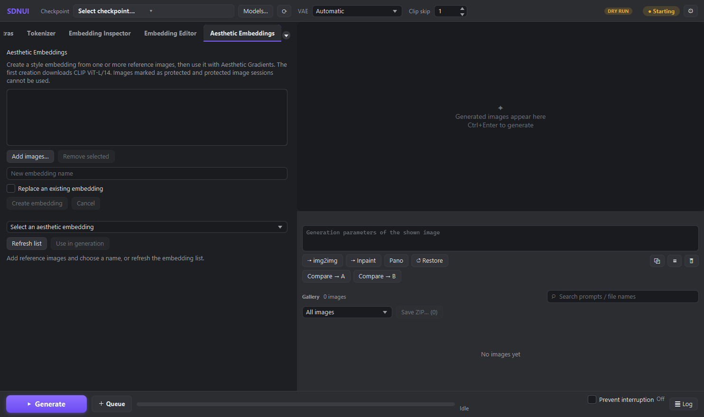

# 参照画像の雰囲気を生成に使う

Aesthetic Gradients は、参照画像から作った embedding を使って、生成画像の雰囲気を変える機能です。まず画像から embedding を作り、生成画面に設定します。初回の作成時には CLIP ViT-L/14 がダウンロードされます。

## 画面から作る



画面例はテスト用の dry-run で撮影しています。

1. **Aesthetic Embeddings** タブを開きます。
2. **Add images…** で参照画像を選びます。1〜32枚を指定できます。
3. 名前を入力し、**Create embedding** を押します。作成したファイルは出力フォルダの `aesthetic_embeddings` に保存されます。
4. 一覧で embedding を選び、**Use in generation** を押します。現在の生成モードで Aesthetic Gradients が有効になります。
5. 生成画面に戻り、Aesthetic Gradients の設定とプロンプトを確認して生成します。

同じ名前のファイルがある場合、通常は上書きされません。置き換えるときは **Replace an existing embedding** を選んでください。既存の embedding を一覧に読み直すには **Refresh list** を押します。

上書きしない作成には、保存先のファイルシステムでハードリンクを使います。exFAT などハードリンクを使えない保存先では作成に失敗します。その場合は NTFS など対応する保存先を選んでください。

処理中は **Cancel** で作成の中断を要求できます。すでに保存が確定した場合や中断が保護されている場合は、画面にその旨が表示されます。保護された画像や保護画像セッション中の画像からは作成できません。

## MCP から使う

MCP の接続方法とアクセス可能なフォルダの設定は [MCP の日本語マニュアル](../site/content/ja/mcp.md) を参照してください。画像パスと、指定する出力フォルダはアクセスを許可されたフォルダ内に置きます。

`aesthetic_embedding` に次の引数を渡すと embedding を作成できます。画像はパス、base64 PNG、または data URI で指定できます。

```json
{
  "operation": "create",
  "name": "my_style",
  "images": ["C:/allowed/reference.png"]
}
```

戻り値の `path` を控えます。`output_dir` を省略すると、現在の出力フォルダの `aesthetic_embeddings` に保存されます。`overwrite` の既定値は `false` です。

出力フォルダはリクエストの開始時に決まります。処理中に設定を変えても、そのリクエストの保存先は変わりません。

一覧を取得するには `{"operation":"list"}` を渡します。別の許可済みフォルダを調べるときは `output_dir` を指定します。生成時は、戻り値のパスを `always_on` に渡します。

```json
{
  "prompt": "a blue ceramic teapot on a wooden table",
  "always_on": {
    "aesthetic_gradients": {
      "enabled": true,
      "embedding": "C:/allowed/aesthetic_embeddings/my_style.pt",
      "weight": 0.3,
      "steps": 5
    }
  }
}
```

この JSON は `txt2img` の引数の例です。画像サイズやモデルなど、ほかに必要な設定は用途に合わせて指定してください。

## 設定と制限

`weight` を大きくすると参照画像の影響が強くなります。元の検証では、特に SDXL で強い設定が画像を崩す場合がありました。まず小さめの値から試し、結果を見ながら調整してください。

SD 1.x と SDXL に対応します。SDXL では二つのテキストエンコーダーのうち CLIP-L 側だけに適用されます。SD 2.x は対応していません。ADetailer の追加処理や、negpip・Embedding Merge の専用テキスト処理には適用されません。元の拡張で作られたファイルや PNG との互換性は未検証です。

生成した PNG から復元するには、embedding を利用できる場所に残しておく必要があります。新しい PNG ではファイルの内容を照合し、一致しない場合や候補が曖昧な場合は自動で復元しません。古い PNG には照合用の情報がないため、名前が一つに決まっても、元と同じ内容かどうかは確認できません。
